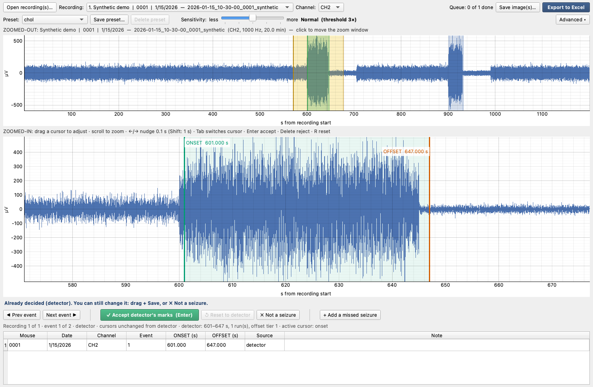

# Seizure On/Off Marker

Semi-automated marking of seizure **onset and offset** times in mouse ECoG/EEG
recorded with [Open Ephys](https://open-ephys.org/). A classical detector
(energy + line-length onset rule, postictal-suppression offset rule) proposes
one onset/offset pair per candidate seizure; a reviewer accepts, drags, rejects
or adds events in an interactive viewer; the approved times go to an Excel
workbook, one sheet per mouse, with a trace image per event and a Parameters
sheet that documents exactly which settings were used.



Works on macOS and Windows (and Linux). No cloud, no account, no internet after
install. Everything runs locally in Python.

## Contents

- [Requirements](#requirements)
- [Install](#install)
- [Run](#run)
- [Try it without data](#try-it-without-data)
- [What your data needs to look like](#what-your-data-needs-to-look-like)
- [Where files go](#where-files-go)
- [Documentation](#documentation)
- [Troubleshooting](#troubleshooting)
- [Command-line detector](#command-line-detector)
- [Development](#development)

## Requirements

| | |
|---|---|
| **Operating system** | macOS 12+ or Windows 10/11 (64-bit). Linux works too. |
| **Python** | 3.10, 3.11, 3.12, 3.13 or 3.14, from [python.org](https://www.python.org/downloads/). On Windows tick **"Add python.exe to PATH"** in the installer. |
| **Disk / RAM** | A recording is loaded one at a time; a 1-hour, 1 kHz channel is ~60 MB in memory. |

Python packages (installed automatically by the setup script, listed in
`requirements.txt` / `pyproject.toml`):

| package | used for | tested with |
|---|---|---|
| numpy | signal maths | 2.4 |
| scipy | notch + band-pass filters, `.mat` loading | 1.17 |
| PyQt6 | the window | 6.10 |
| pyqtgraph | fast EEG plotting | 0.14 |
| matplotlib | trace images for Excel / PNG | 3.10 |
| openpyxl | Excel workbook writing, lab-log reading | 3.1 |
| pillow | image embedding in Excel | 12 |

## Install

Get the folder onto the computer either with git (`git clone <this repo>`) or
with **Code ▾ → Download ZIP** on GitHub and unzip it. Then run the setup once.
It creates a private Python environment (`.venv`) inside the folder and installs
the packages above; nothing else on the computer is touched.

### macOS

1. Open the folder in Finder, go into `launchers`, double-click
   **`setup_mac.command`**. A Terminal window shows progress and ends with
   "Done".
   - If macOS says the file "cannot be opened because it is from an unidentified
     developer": right-click the file → **Open** → **Open**. This is only needed
     the first time, and only for a downloaded ZIP (not for a git clone).
2. Start the app by double-clicking **`Seizure Marker.app`** in the folder (or
   `launchers/Seizure Marker.command`). Drag the `.app` to the Dock if you like.

### Windows

1. Open the folder in Explorer, go into `launchers`, double-click
   **`setup_windows.bat`**. A console window shows progress and ends with "Done".
   - If Windows SmartScreen appears, choose **More info → Run anyway**.
2. Start the app by double-clicking **`launchers\Seizure Marker.bat`**. Right-click
   it → *Send to → Desktop (create shortcut)* for a desktop icon.

### Manual (any OS)

```bash
cd seizure-marker
python -m venv .venv
# macOS / Linux:            Windows:
source .venv/bin/activate   # .venv\Scripts\activate
pip install -e .
seizure-marker              # or: python -m seizure_marker
```

## Run

Start the app, then **Open recording(s)…** or drag a folder onto the window.
Any folder works: every Open Ephys recording underneath it is queued, so you
open a whole experiment folder at once and work through it. For each candidate
event the window shows the whole recording (top), a zoomed view with draggable
ONSET and OFFSET cursors (middle), and one line in bold that says what to do.

| action | button | key |
|---|---|---|
| keep the cursors as shown (detector's, or as you dragged them) | **✓ Accept / Save** | Enter |
| undo your dragging | **↺ Reset to detector** | R |
| the event is not a seizure | **✗ Not a seizure** | Delete |
| the detector missed one | **+ Add a missed seizure**, then drag and Save | |
| move between events / recordings | **◀ Prev / Next ▶** | P / N |
| nudge the active cursor 0.1 s (Shift: 1 s); switch cursor | | ← → ; Tab |

After each decision the next undecided event appears. Every decision is saved
immediately; close the app and reopen the same folder and you continue where you
left off. **Export to Excel** writes the workbook when you are done.

Command-line options (optional):

```bash
python -m seizure_marker "D:\EEG\2026 cohort"           # start with this folder queued
python -m seizure_marker PATH --channel CH9              # force the channel for every recording
python -m seizure_marker PATH --profile lc               # start with another preset
python -m seizure_marker PATH --out "~/Desktop/marks"    # autosave + export location
```

The full description of every control, the detector and every parameter is in
[docs/USER_GUIDE.md](docs/USER_GUIDE.md).

## Try it without data

```bash
python -m seizure_marker.synthetic          # writes ./synthetic_demo/2026-01-15_10-30-00_0001_synthetic/
python -m seizure_marker synthetic_demo     # open it
```

The synthetic recording has two fake seizures on CH2 (600–645 s and 900–930 s)
with a postictal quiet period after each. The detector finds both; try dragging,
rejecting, adding and exporting.

## What your data needs to look like

**Recordings.** Open Ephys binary format, i.e. a folder containing
`structure.oebin` under a `Record Node NNN/experimentN/recordingN/` tree. The
amplifier stream (the continuous stream with the most channels) is used; channel
names are the Open Ephys names (`CH1`, `CH2`, …). The sampling rate comes from
`structure.oebin`; if it is missing or wrong, set it in **Advanced ▾ → Sampling
rate**. `.mat` files with one Nx1 variable are supported by the command-line
detector (`--fs` required).

**Folder names.** Mouse number and date are read from the recording folder's
name, which Open Ephys creates as `YYYY-MM-DD_HH-MM-SS` plus whatever you typed
as the recording name. Put the mouse number first in that name, e.g.

```
2025-12-03_10-47-07_4826het_seizure1
2026-09-24_16-20-21_5818het_grabACH_PTZ
```

The first 3–5 digit number after the time stamp is the mouse ID. Without it the
Mouse column is empty and the lab log cannot be matched.

**Lab log (optional).** If an Excel file with `log` in its name
(e.g. `DG_grabNE_log.xlsx`) sits in any folder above the recording (up to 5
levels), the app matches the recording's mouse and date to a row and takes the
channel and session number from it. Expected layout: title in row 1, header in
row 2, one row per session, with at least these columns:

| column header | content |
|---|---|
| `mouse ID #` | mouse number, matches the folder name |
| `date` | `YYYYMMDD` |
| `channel(s): ECoG` | channel number (e.g. `2` → CH2) |
| `heating session #` | session number (optional) |

The dataset label in exports is the name of the folder holding the log (a
leading number is stripped: `6 DG ACH hot seizure` → `DG ACH hot seizure`).
Without a log, the channel is CH2 (or `--channel`), changeable in the toolbar.

## Where files go

| what | where |
|---|---|
| autosaved decisions | `~/SeizureMarker/marker_session.json` (`--out` changes the folder) |
| Excel export, saved images | wherever you choose in the dialog (defaults to the same folder) |
| your saved presets | `~/.seizure_marker_presets.json` |
| command-line detector output | `./output/<recording>/` (`--out`) |
| macOS launcher log | `~/Library/Logs/SeizureMarker.log` |

`~` is your home folder (`/Users/<you>` on macOS, `C:\Users\<you>` on Windows).

## Documentation

- [docs/USER_GUIDE.md](docs/USER_GUIDE.md): every control, every parameter with
  a definition, what the Parameters sheet contains, a sample methods paragraph.
- [docs/DETECTOR_DETAILS.md](docs/DETECTOR_DETAILS.md): how the detector works,
  how each value was chosen, known failure modes.
- [CHANGELOG.md](CHANGELOG.md).

## Troubleshooting

| symptom | fix |
|---|---|
| macOS: "cannot be opened because it is from an unidentified developer" | Right-click → Open (once). The setup script also clears the download quarantine flag from the launchers. |
| macOS: app bounces then closes | Run setup first; then look at `~/Library/Logs/SeizureMarker.log`. |
| Windows: "python is not recognized" | Reinstall Python from python.org with **Add python.exe to PATH** ticked, or install the `py` launcher (included by default). |
| `qt.qpa.plugin: Could not load the Qt platform plugin` | Linux: `sudo apt install libegl1 libgl1 libxkbcommon-x11-0 libxcb-cursor0`. Windows: reinstall with `pip install --force-reinstall PyQt6`. |
| "No Open Ephys recordings (structure.oebin) found" | The folder you opened has no `structure.oebin` below it; check you chose the recording or experiment folder, not the `continuous` folder inside it. |
| "no EEG data in this recording (continuous.dat is missing or empty)" | The recording was not copied completely. The row is kept in the queue with ⚠ so it is not forgotten. |
| Export fails with "Permission denied" | The workbook is open in Excel. Close it and export again. |
| Wrong channel or no events | Check the Channel dropdown; raise Sensitivity; see the preset table in the user guide. |

## Command-line detector

The same detector without the window, for batch runs and scripts:

```bash
seizure-marker-cli run PATH --channel CH2 --profile chol --out output
seizure-marker-cli run recording.mat --fs 500 --profile ppn
```

Writes `output/<name>/events.csv` (onset, offset, duration, offset tier, merged
runs, baseline) and one PNG per event. `python -m seizure_marker.detector` is
the same command.

## Development

```bash
pip install -e ".[dev]"
python -m pytest -q          # detector, session and headless GUI tests on a synthetic recording
```

Layout:

```
seizure_marker/
  app.py                PyQt6 window
  session.py            data model: queue of recordings, marks, presets, autosave, lab-log lookup
  export.py             Excel workbook (per-mouse sheets + Parameters) and PNG saving
  plots.py              trace images, print layout
  detector.py           loading (.oebin / .mat), onset detector, offset rule, CLI
  energy_ll_core.py     rolling-median / persistence primitives shared with the lab's live detector
  signal_processing.py  60 Hz notch + 1-70 Hz band-pass
  synthetic.py          synthetic recording generator
launchers/              double-click setup and start scripts for macOS and Windows
Seizure Marker.app      macOS app bundle (shell launcher + icon) that runs the .venv
tests/                  pytest suite (runs headless)
docs/                   user guide, detector details, screenshot
```

Tests run in GitHub Actions on Ubuntu, macOS and Windows (`.github/workflows/ci.yml`).

## License

MIT, see [LICENSE](LICENSE). Developed in the Mattis Lab for Scn1a / cholinergic
mouse ECoG studies.
